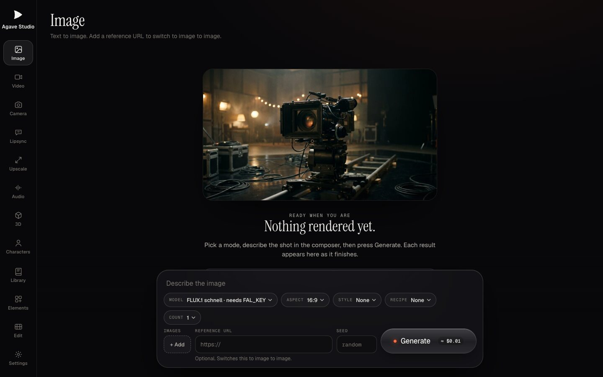

<p align="center">
  <picture>
    <source media="(prefers-color-scheme: dark)" srcset="web/assets/brand/mark.svg">
    
  </picture>
</p>

<h1 align="center">Agave Studio</h1>

<p align="center">
  One studio for AI image, video, voice and 3D, with a video editor built in.<br>
  Free and open source. Bring your own API keys.
</p>

<p align="center">
  <a href="LICENSE"></a>
</p>



There are no plans, credits or accounts. You add a key from a provider such as fal.ai and pay them directly for
what you make. For fal.ai models the studio shows the provider's list price before you press Generate (Meshy jobs
show their credit cost). Keys are stored only on your computer, and the app has no analytics.

## What it does

- **Generate:** text to image, image to image, text to video, image to video, voice, and image to 3D, from one
  queue. `gateway/models.toml` lists the composer's models.
- **Direct:** 20 camera moves, 10 looks, a prompt library, and Elements: saved characters or products you call
  with `@tag`.
- **Pipelines:** Library flows that run several steps in a row (product photo to hero still, video and 3D model;
  character sheet to two joined clips). The full price shows first and every paid step waits for your click.
- **Edit:** trim and join clips, auto captions, remove pauses, reframe to 9:16, clean up voice, and set loudness
  to -14 LUFS.
- **Playground:** fal's models that make pictures, video, audio or 3D, each with its own controls built from fal's own
  description of the model. It opens with a working example, shows fal's price before you press Run, and keeps every
  run with Tweak, Get code and Download. Compare sends one prompt to up to four models side by side, with each one's
  price before and its result and time after. Open it from the studio's rail or at `/app/playground.html`.

## Run it

Agave Studio runs on macOS and Linux. You need:

- [Rust](https://rustup.rs) 1.88 or newer (install it with rustup; distro packages are often older),
- a C++17 compiler (on macOS, the Xcode Command Line Tools: `xcode-select --install`; on Debian or Ubuntu,
  `build-essential`),
- [ffmpeg](https://ffmpeg.org) on your PATH,
- for captions on Linux (or on a Mac without the Parakeet tool below): [whisper.cpp](https://github.com/ggml-org/whisper.cpp)'s
  `whisper-cli` on your PATH (on a Mac, `brew install whisper-cpp`).

On Windows, run it inside [WSL](https://learn.microsoft.com/windows/wsl/) with the Linux steps; it does not build as a
native Windows program.

```sh
git clone https://github.com/LayerMakerLab/agave-studio.git
cd agave-studio/gateway
cargo run --release        # the site and engine on http://127.0.0.1:4170
```

Then open <http://127.0.0.1:4170/app/>. On first launch the studio walks you through setup: paste a provider key,
then download the speech model for captions (a one-time, free download). You can reopen setup from Settings.

To try the studio without a key or spending anything, start it with `AGAVE_FAKE_PROVIDERS=1 cargo run --release`:
every model answers locally with a placeholder that says TEST OUTPUT, and its data stays in `data/fake-providers`
([docs/API.md](docs/API.md)). The Playground then offers seven real fal models saved in the repository; the engine
reaches no network, though fal's example pictures still load in your browser from fal's servers.

The gateway only listens on 127.0.0.1 (port 4170; test mode can move it with `AGAVE_TEST_PORT`). It has no sign-in,
so do not expose it to a network. It reads `web/`,
`config/` and `data/` from the checkout it was built in, so run it from there.

## Providers and keys

Paste keys in the studio's Settings, or put them in `config/keys.env` (copy `config/keys.example.env`). Environment
variables with the same names also work.

| Provider | Key | What it unlocks |
|---|---|---|
| [fal.ai](https://fal.ai) | `FAL_KEY` | Kling, Seedance, Wan, Hailuo, Veo, FLUX, Nano Banana, Seedream |
| [Replicate](https://replicate.com) | `REPLICATE_API_TOKEN` | FLUX schnell |
| [Google Gemini](https://ai.google.dev) | `GEMINI_API_KEY` | Nano Banana |
| [OpenAI](https://platform.openai.com) | `OPENAI_API_KEY` | GPT Image |
| [Black Forest Labs](https://bfl.ai) | `BFL_API_KEY` | FLUX 1.1 pro, FLUX.2 pro |
| [ElevenLabs](https://elevenlabs.io) | `ELEVENLABS_API_KEY` | Text to speech |
| [Meshy](https://www.meshy.ai) | `MESHY_API_KEY` | Image to 3D (GLB, USDZ, STL, 3MF) |

Every model id and request shape in `models.toml` was checked against the provider's own docs or API schema; each
entry notes what was checked and when. Not every model has had a live run yet, so if one fails, please open an issue.

## macOS extras (optional)

These need macOS 14 or later and Xcode's Swift tools.

- **Captions with Parakeet** (on-device, fast): `native/speech/build.sh`. Without it, captions use
  [whisper.cpp](https://github.com/ggml-org/whisper.cpp): put `whisper-cli` on your PATH and pick Whisper in setup.
- **Follow reframe** (keeps the subject in frame for 9:16): `native/vision/build.sh`.
- **Mac app**: run `cargo build --release` in `gateway/` first, then `native/macos/build-app.sh` builds
  `native/macos/build/Agave Studio.app`, which starts the gateway
  from this checkout.

## Privacy

- Keys stay in `config/keys.env` on your computer; the studio writes that file with mode 0600 and never sends a
  saved key back.
- Prompts and files go only to the provider you pick, using your key.
- Captions and transcripts run locally.
- The Playground reads fal's model list, each model's form and its price from api.fal.ai, sending your fal key with
  those reads when one is set (fal allows more of them with a key). The model pictures in the list load in your browser
  from the addresses fal gives for them (fal's servers and Google Cloud Storage), with no referrer.
- No analytics, no telemetry, no account. The studio's fonts ship with it; the homepage
  (`web/index.html`, not the studio) loads its headline font from Google Fonts. The studio's page policy lets it call
  only itself, so the 3D viewer cannot fetch Draco or KTX2 decoders: a compressed model does not display
  (`web/vendor/README.md`).
- The `data/` folder (outputs, job history) is owner-only on disk. While the gateway runs, any program on this
  computer can call it on 127.0.0.1; see [SECURITY.md](SECURITY.md).

## Layout

| Path | What |
|---|---|
| `gateway/` | Rust (axum) engine: the API, provider adapters, jobs, rendering with ffmpeg |
| `engine/promptcraft/` | C++ camera and style phrases, linked into the gateway |
| `web/` | The site (`/`) and the studio (`/app/`): plain HTML, CSS and JavaScript, no build step |
| `native/` | Optional macOS tools: speech, vision and the Mac app |
| `docs/API.md` | The gateway's HTTP API |

## Develop

```sh
cd gateway
cargo test --release       # makes no network calls
cargo clippy --all-targets
```

See [CONTRIBUTING.md](CONTRIBUTING.md) and the [Code of Conduct](CODE_OF_CONDUCT.md). To report a security problem,
see [SECURITY.md](SECURITY.md).

## License

Apache License 2.0. See [LICENSE](LICENSE) and [NOTICE](NOTICE). Speech models are downloaded from Hugging Face
under their own licences: Parakeet TDT 0.6B v3 (CC-BY-4.0) and whisper.cpp's Whisper small (MIT).
